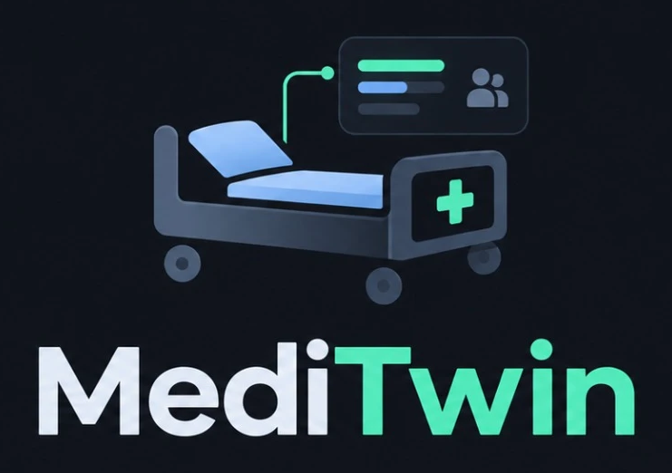

<p align="center"></p>

# MediTwin — Smarter Hospital Resource Allocation

A full-stack hospital **bed and equipment command center** with an explainable **AI allocation engine** and a data-driven **3D bed inventory**.
Staff see at a glance how many beds are free in every ward, what equipment is ready, who is waiting — and the AI proposes where every waiting patient should go, explains why, and tells you how to unblock patients it can't place.

> Ideathon prototype. All data is fictional. Not clinically validated, not connected to any hospital system. The AI optimizes **resource fit** (bed type, features, devices, ward load); it never diagnoses or triages, and staff approve every allocation.

## Quick start

Requirements: **Python 3.11+** and **Node.js 20+**.

```bash
powershell -ExecutionPolicy Bypass -File start.ps1
```

On macOS / Linux / Git Bash: `./start.sh`. Both install dependencies on first run, build the UI and serve everything at **http://localhost:8000**.

| Option | PowerShell | Bash |
|---|---|---|
| Hot-reload dev mode (API :8000, UI :5173) | `start.ps1 -Dev` | `./start.sh --dev` |
| Start with fresh demo data | `start.ps1 -Reset` | `./start.sh --reset` |

API docs (Swagger) are at http://localhost:8000/docs.

## What's inside

| Screen | What it does |
|---|---|
| **Dashboard** | AI briefing (one-line situation report + prioritized actions), beds free, 24 h occupancy forecast, admission queue, equipment readiness, ward capacity board, status mix, alerts and activity. Every figure is computed from stored records and refreshes live. |
| **Bed Allocations** | The 3D bed workspace: ward list, status chips as filters, auto-laid-out sections, click to select, zoom / rotate / auto-rotate / reset, compass, list fallback, a detail panel with Details / Equipment / Patient tabs and valid actions (assign patient, edit bed, status changes), plus ward overview, recent activity, quick actions and alerts. **Place mode** (`?for=<patient>`) highlights only the AI best-fit beds with their match score and lets staff confirm there. An all-wards bed table is at **All beds** (`/beds`). |
| **Patients** | Flow board: Waiting → Matching → Allocated → Admitted, with stage tiles, filters, paging, and a detail panel (stage stepper, requirements, AI-ranked beds with score breakdowns, unlock suggestions, admit / cancel / discharge / transfer, edit). |
| **AI Allocation** | **Plan**: places the whole queue at once, explains each pick, compares against manual first-come-first-served, and lets staff approve all or some. Patients it can't place get one-click **unlock actions**. **Forecast**: per-ward occupancy projection (12–72 h) with a demand-surge slider. |
| **Equipment** | Individually tracked devices (reserved automatically with allocations) and counted stock. |
| **Alerts** | Live alerts from configurable thresholds, and the full activity history. |
| **Reports** | Occupancy, equipment utilization, allocation history (AI vs manual source and match score), and a read-only demand-surge simulation. |
| **Setup** | Wards (create / edit / deactivate), safe bed-count changes, demo data seed / reset, and a data-consistency check. |
| **Settings** | Alert thresholds, device minimums, visual section size, release-to-cleaning, cleaning turnaround, hospital name, bed-type compatibility. |

**Design — "Graphite".** Dark glass theme: floating glass rail and top bar, glass panels, and a strict 10-colour palette used everywhere, including the 3D beds and form controls — base `#111315`, panel `#1b1f23`, raised `#2c3238`, slate `#4f6e85`, fog `#8da4b3`, pearl `#eef3f6`, accent `#7db4e6`, mint `#5ed3a5`, coral `#f3786a`, amber `#f4c35a` (defined once in `frontend/src/styles/graphite.css`, mirrored in `frontend/src/scene/bedScene.ts`). Fonts (Manrope, JetBrains Mono) are bundled, so the app works offline. Old `/explorer` links redirect to Bed Allocations.

**MediTwin AI assistant** (top bar, or `Ctrl K`): ask "How many beds are free?", "Where should P-9003 go?", "Plan beds for the whole queue", "Are we short on ventilators?". It reads live data and can propose an allocation as a confirmation card. It runs fully offline with a built-in engine; set `GROQ_API_KEY` in `.env` to answer with Groq's **GPT-OSS 120B** (`openai/gpt-oss-120b`) using the same read-only tools. If Groq is unreachable it falls back to the built-in engine automatically.

## How the AI works

1. **Hard rules** — a bed qualifies only if it's available, of the requested or a configured compatible type, has every required feature, and a free device of each required type exists in its ward or the shared pool. The server re-applies these rules when an allocation is confirmed.
2. **Explainable match score (0–100)** — bed type 30 · features 20 · devices ready 20 · keeps scarce beds free 15 · ward suits care category 10 · balances ward load 5.
3. **Whole-queue planner** — staff-set priority tiers first; inside a tier the *most constrained* patient is placed first so scarce beds (isolation-capable, bariatric, ventilator-ready) aren't consumed by patients with many options. Devices are re-checked after every pick. The plan is compared with manual first-come-first-served. In the demo data it places one more patient (P-9009 gets the only free isolation-capable ICU bed).
4. **Unlocks** — for anyone left unplaced it finds what would create a bed: finish cleaning a bed, release a reservation, return a device from maintenance, or allow a compatible bed type.
5. **Forecast** — projects occupancy from typical stay lengths, cleaning turnaround and a daily arrival curve; clearly labelled as simulated planning assumptions.

## Architecture

```
backend/   FastAPI · SQLAlchemy 2 · SQLite (WAL) · Pydantic
  app/services/rules.py      eligibility, match scoring, integrity checks
  app/services/patients.py   patients, flow board, allocate / admit / cancel / release
  app/services/inventory.py  wards, beds, equipment
  app/services/ai.py         planner, unlocks, forecast, briefing
  app/services/assistant.py  offline intent engine + optional Groq gpt-oss-120b tool-calling loop
  app/seed.py                idempotent fictional demo data
frontend/  React 19 · TypeScript · Vite · TanStack Query · Three.js · Recharts · Graphite CSS
  src/styles/graphite.css    the design system (10-colour palette, glass surfaces, every component class)
  src/components/g/          shared design pieces (icons, chips, stat cards, donut, modal, confirm)
  src/scene/bedScene.ts      instanced 3D bed stage (auto layout, picking, camera)
  src/pages/                 Dashboard, Allocations, AllBeds, Patients, AI, Equipment, Alerts, Reports, Setup, Settings
```

**Data integrity.** Every mutation runs in a `BEGIN IMMEDIATE` SQLite transaction: it takes the write lock, re-reads the latest state, checks all rules, runs integrity checks, and commits or rolls back completely. Partial unique indexes guarantee at most one active allocation per bed and per patient at the database level. Two users racing for the same bed get one success and one `409`. Errors are structured: `{"error": {"status", "code", "message", "details"}}`.

## Tests

```bash
cd backend && .venv/Scripts/python -m pytest -q      # (.venv/bin/python on macOS/Linux)
cd frontend && npm test
```

Backend tests cover unique codes, bed generation, unsafe reductions, ineligible statuses, type / feature / equipment mismatches, duplicate allocations, **concurrent allocation conflicts**, admit / release / cancel consistency, dashboard totals vs records, persistence across restart, the AI plan (no double-booked beds or devices, urgent first, beats FCFS), unlocks, forecast, read-only simulation, and the assistant. Frontend tests cover the 3D auto-layout (no overlaps, beds inside sections) and formatting helpers.

## Configuration

Copy `.env.example` to `.env`. All settings are optional: database path, seeding on start, and `GROQ_API_KEY` for the Groq-powered assistant.

## Known limitations

- Demo role only ("Demo Staff"); no authentication.
- Single-site SQLite database; data stays on this machine.
- Forecast and surge simulation use stated planning assumptions, not real patient predictions.

Product and technical specs are in `docs/`.
